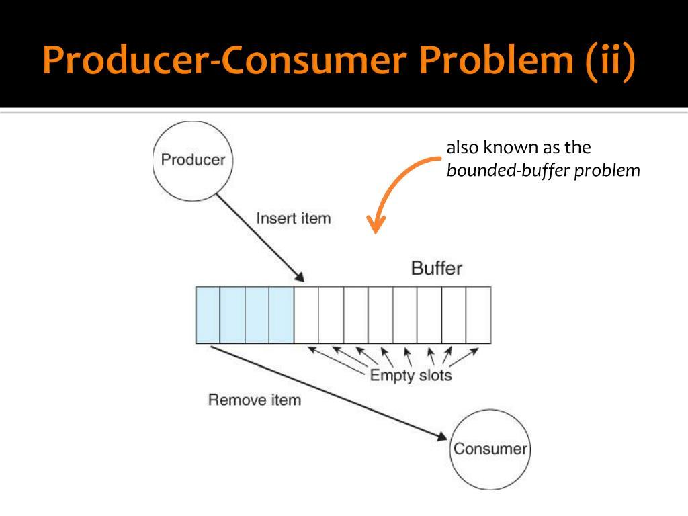
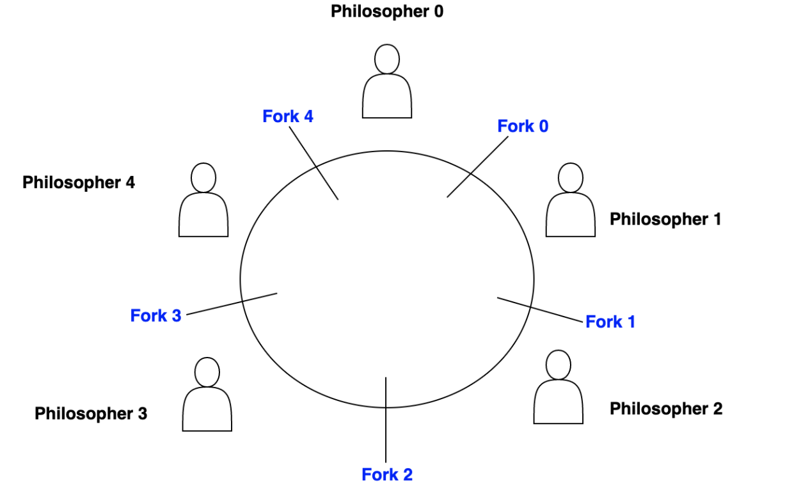

# Projeto de Sistemas Operacionais

Este projeto apresenta a implementação e a resolução de dois problemas clássicos de concorrência em Sistemas Operacionais, utilizando a linguagem C e processos para representar os elementos envolvidos.

## Objetivo

Aplicar conceitos de concorrência e sincronização estudados na disciplina de Sistemas Operacionais, compreendendo os desafios do compartilhamento de recursos entre processos e suas possíveis soluções.

## Problema 1 – Produtor-Consumidor

O problema do Produtor-Consumidor consiste em controlar o compartilhamento de um buffer limitado entre processos produtores e consumidores.

Os produtores são responsáveis por inserir itens no buffer, enquanto os consumidores removem esses itens. É necessário garantir que nenhum produtor insira elementos quando o buffer estiver cheio e que nenhum consumidor tente remover elementos quando estiver vazio.

(Imagem retirada do site SlideServe: https://www.slideserve.com/adie/operating-systems-week-10-powerpoint-ppt-presentation)

**Solução implementada:**

- Utilização de `fork()` para criar os processos produtores e consumidores.
- Utilização de `mmap()` para criar uma região de memória compartilhada contendo o buffer.
- Utilização de semáforos para controlar as posições disponíveis e os itens existentes no buffer.
- Utilização de um mutex para garantir a exclusão mútua durante o acesso ao buffer.

Dessa forma, os processos conseguem produzir e consumir itens simultaneamente, respeitando os limites do buffer e evitando condições de corrida.

## Problema 2 – Jantar dos Filósofos

O problema do Jantar dos Filósofos representa cinco filósofos sentados ao redor de uma mesa, cada um com dois garfos adjacentes. Para comer, cada filósofo precisa adquirir os dois garfos, alternando entre os estados de pensar e comer.

O principal desafio é impedir que dois filósofos utilizem o mesmo garfo simultaneamente e evitar situações de deadlock, nas quais todos os filósofos ficam bloqueados esperando por recursos.

(Imagem retirada do site Educative.io: https://www.educative.io/courses/c-sharp-concurrency-for-senior-engineering-interviews/dining-philosophers)

**Solução implementada:**

- Utilização de `fork()` para criar cinco processos, um para cada filósofo.
- Utilização de `mmap()` para compartilhar os mecanismos de sincronização entre os processos.
- Utilização de cinco semáforos, um para cada garfo, garantindo que apenas um filósofo utilize cada garfo por vez.
- Utilização de um semáforo adicional, com valor inicial 4, limitando a quantidade de filósofos que podem disputar os garfos simultaneamente.
- Utilização de um mutex para proteger as regiões críticas de impressão no terminal.

A limitação de quatro filósofos na disputa pelos garfos evita o deadlock, permitindo que pelo menos um filósofo consiga adquirir os dois garfos e concluir sua refeição.

## Tecnologias e recursos utilizados

- Linguagem C
- Processos (`fork()`)
- Memória compartilhada (`mmap()`)
- Semáforos POSIX (`sem_t`)
- Mutex POSIX (`pthread_mutex_t`)
- Sincronização entre processos

